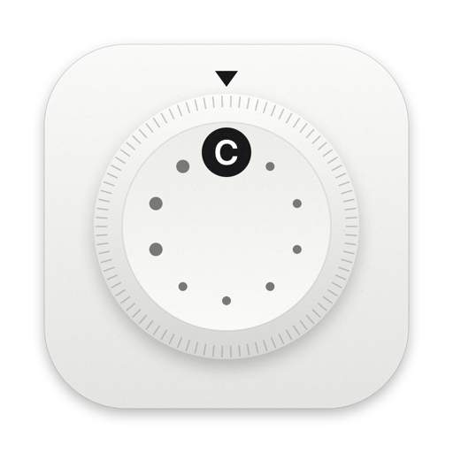

<div align="center">

# Fuji Recipes

**Your Fujifilm's custom slots and your recipes. For you and your agents.**

Plug a Fujifilm X camera into the Mac, see what's in C1–C7, and write film-simulation recipes into the slots,
with a backup first and a read-back after. Keep a recipe library of your own recipes (found in your photos'
EXIF), recipes from reels and websites, and kits of seven for a trip. Ask Claude to do any of it through MCP.
Native Swift, on-device, nothing uploaded.

[](https://swift.org)
[](#install)
[](#for-agents-mcp)
[](LICENSE)
[](#status)

<br>

[](https://github.com/vekaev/fuji-recipes/releases/latest/download/FujiRecipes-mac.dmg)

<sub>The Mac app updates itself. One more line in Terminal (below) adds the <code>fuji</code> CLI, its MCP server for Claude, and the /recipe skill. Apple Silicon + Intel, macOS 14+.</sub>

</div>

## Status

Early. The `fuji` CLI and MCP server read a real X-E5 (all slots, FS1–FS3, a full settings backup) and write
slots end to end against a simulated X-E5 that refuses what real bodies refuse; the first real write is next. The apps
for Mac, iPhone and iPad run on the same `FujiKit`. Why this app and not another one: [the research brief](docs/research/brief.md).

## The app (Mac, iPhone, iPad)



**Fuji Recipes** (early) in [Photo Minimalist](https://github.com/vekaev/photo-minimalist)'s style. You pick a recipe
by how it looks, not by its numbers, so the photos come first and the settings sit behind "Settings ›".

- **Recipes**: every recipe as its name, a short description, three photos (tap for the big preview), tags such as
  B&W or "Leica style". Edit › renames it and changes its description, status, tags and source.
  On the Mac and a wide iPad the camera's slots sit beside it: drag a look onto a slot.
- **The camera** (beside the recipes on Mac / iPad, its own tab on iPhone): C1–C7 and the dial's FS1–FS3 with the look in each. A slot shows since when it holds that look, when
  you last shot with it, looks to swap in, and its history, so you can put the old one back. Changes are staged and
  written right away: a backup first, a read-back after, Undo in the message. FS1–FS3 (the film simulation dial) are
  written too, through the camera's settings file; their WB shift and B&W toning stay as set on the camera for now.
  When you plug the camera in, any recipe on it that your library doesn't have yet is added as yours, named after the
  slot, with the photos you shot with it (on the Mac: your Fujifilm JPEGs and any memory card that's in; insert the
  card later and the photos join then). Undo is in the message; the setting is in the ⋯ menu.
- **Studio**: pick one of your RAW photos and see it developed by your camera with each recipe, side by side, the way
  FUJIFILM X RAW Studio does it (the camera does the work, so it's the real look). It starts by itself when the camera
  is connected, in big cards across the whole window; arrows move, Space opens one big (developed again at full size),
  P picks it for this photo to decide later, F favorites the recipe. Paste (⌘V) a RAF copied in Finder instead of
  choosing one. Renders are kept, so the sheet opens instantly next time.
- **Match a look**: drop in any photo you love (a Leica shot, a film scan, a post) and get the recipe that brings your
  camera closest. A first guess comes from your library's photos straight away; then your X-E5 develops one of your
  RAWs with candidate recipes (about 50, ~2 s each) and you get the three closest next to your photo, with a match %,
  to save as To try. `fuji match --evaluate` shows how accurate the guesses are on your own library, and
  `fuji match --benchmark` how often the camera search finds a hidden recipe again.
- **Add recipes**: paste or drop Instagram / TikTok / YouTube links (many at once) or Instagram's saved-posts export.
  Claude reads the reels on the Mac (`/recipe`, `fuji_inbox`), and you keep or skip each one here.
- No camera yet: a step-by-step guide to the camera's USB mode, with a live connection check.

Mac: `scripts/install-mac.sh` (needs Xcode and `brew install xcodegen`). iPhone / iPad: `scripts/run-ios-sim.sh`
for the simulator, or run the `FujiRecipes-iOS` scheme on a device with a USB-C port. The library lives in
`~/Documents/FujiRecipes`, or in iCloud Drive's "Fuji Recipes" folder so every device sees it. A downloadable Mac
app with auto-updates comes with its first release.

<br clear="left">

## Install

### The Mac app

**One line in Terminal** (no security prompt):

    curl -fsSL https://raw.githubusercontent.com/vekaev/fuji-recipes/main/scripts/install-app.sh | sh

It downloads the latest release, puts Fuji Recipes in Applications and opens it.

**Or the DMG:** [download](https://github.com/vekaev/fuji-recipes/releases/latest/download/FujiRecipes-mac.dmg), open it
and drag Fuji Recipes to Applications. The first time, if your Mac says it can't check the app, open
System Settings ▸ Privacy & Security and click **Open Anyway** (once; Fuji Recipes isn't notarized yet).

Either way it updates itself: once a day, or right away via *Fuji Recipes ▸ Check for Updates…*.
Needs macOS 14 or later, Apple Silicon or Intel. iPhone / iPad: build from source for now (TestFlight later).

### The CLI and MCP server (for Claude)

**One line in Terminal** (no security prompt):

    curl -fsSL https://raw.githubusercontent.com/vekaev/fuji-recipes/main/scripts/install.sh | sh

It downloads the latest release, checks its SHA-256, installs `fuji` into
`~/Library/Application Support/FujiRecipes/bin` (linked as `~/.local/bin/fuji`), adds the `/recipe` skill, and
registers the MCP server with Claude Code and the Claude desktop app (quit and reopen Claude once). Run it again,
or `fuji update`, to update; `fuji version --check` says whether there's a newer release. Optional:
`brew install exiftool` for recipes from your photos.

From a checkout instead: `scripts/dev-install.sh` builds, signs and installs the same way.

## Get started

```sh
fuji doctor             # is the camera connected, step by step
fuji status             # is the camera there, and in the right USB mode?
fuji slots              # what's in C1–C7
fuji mine               # the recipes you actually shot with (your JPEGs' EXIF; --write files them)
fuji --simulate slots   # try everything against a simulated X-E5
```

### Plug in your camera

The camera must be in **USB RAW CONV./BACKUP RESTORE** mode; out of the box it's a card reader, which shows only
your photos.

1. On the camera, once: **MENU/OK ▸ network/USB tab ▸ CONNECTION MODE ▸ USB RAW CONV./BACKUP RESTORE**.
2. Same tab, once: **USB POWER SUPPLY/COMM SETTING ▸ AUTO**.
3. Every time: **camera off ▸ USB-C data cable into the Mac ▸ camera on**.
4. Check: `fuji doctor`, or ask Claude "is my camera connected?".

**New to this?** [Connect your Fujifilm](docs/CONNECT.md) (the USB mode, step by step, and `fuji doctor` when it
doesn't work) · [Use C1–C7 and FS1–FS3](docs/USING-SLOTS.md) (the dial decides which one you shoot with).

## For agents (MCP)

`fuji mcp` is an MCP server over stdio. The installer adds it to Claude Code (user scope) and the Claude desktop
app. To add it by hand to the desktop app, put this in `~/Library/Application Support/Claude/claude_desktop_config.json` and restart Claude:

```json
{ "mcpServers": { "fuji": { "command": "/Users/<you>/Library/Application Support/FujiRecipes/bin/fuji", "args": ["mcp"] } } }
```

Any other MCP client: run `fuji mcp`.

| Tool | Does |
|---|---|
| `fuji_camera` | connected camera, firmware, USB mode, number of slots, what to fix if it isn't found |
| `fuji_doctor` | the connection checked step by step (USB → camera → session → mode → slots) with the fix for what fails |
| `fuji_slots` | every slot: name, settings, summary, matching library recipe |
| `fuji_recipes`, `fuji_recipe` | the library, one recipe in full with the text to dial it in |
| `fuji_compare` | two recipes or slots ("C3"), field by field |
| `fuji_kits`, `fuji_backups`, `fuji_guide` | kits, saved snapshots, every field's values and the camera's rules |
| `fuji_save_recipe`, `fuji_set_status`, `fuji_save_kit`, `fuji_save_slot` | library edits (checked against what the camera accepts; duplicates refused) |
| `fuji_import_photos` | recipes from your Fujifilm JPEGs' EXIF (needs `brew install exiftool`) |
| `fuji_sync_slots` | the camera's recipes your library doesn't have, added with the photos you shot with them |
| `fuji_backup` | snapshot every slot into the library |
| `fuji_plan_write` → `fuji_apply_write` | camera writes: a preview of every change first; apply only after you approve. Apply backs up all slots, writes only what differs in the camera's order, reads each slot back and reports anything refused |

Reads change nothing. Restore any backup with `fuji_plan_write {"operations": [{"restore": "latest"}]}`.
Every tool also runs from the shell: `fuji call <tool> '<json>'`, `fuji tools` lists them.

## Recipes from reels (`/recipe`)

`skills/fuji-recipes` is an agent skill (Claude Code, Codex): give it an Instagram reel, TikTok or YouTube link,
screenshots or a caption, and it reads the recipe from the frames, caption, comments and speech. It shows you
every value with where it came from, marks the ones to check, credits the creator and saves the recipe through
`fuji`. The installer links it; `/recipe mine` files the recipes you shot with.

## The library

`~/Documents/FujiRecipes` (or `$FUJI_RECIPES`), shared with the `/recipe` skill (reels → recipes):

```
recipes/<slug>.json    one recipe; the source of truth (skills/fuji-recipes/references/schema.md)
kits/<slug>.json       {name, slots: {C1: slug, …}}
backups/<date>-<model>.json   every slot before each write
library.md             generated index
```

## Cameras

Slot writes work over plain USB on X-T5, X-H2/H2S, X100VI, X-T50, **X-E5**, X-S20, X-M5, X-S10, X-T30 II, GFX100S,
GFX100 II, GFX100RF; X100V partly. Not on X-T3, X-T30 and older (no slot properties) or X-Pro3. X-T4 and X-E4:
untested. FS1–FS3 on the X-E5's film simulation dial are **read** from the camera's settings file (`fuji slots`;
`fuji backup --full` saves that whole file, like X Acquire); writing them is not supported yet.

First real-camera run (X-E5 fw 1.12, 2026-11-04): mode detection, all 7 slots, the live settings, the 70,524-byte
settings file and FS1–FS3 read correctly; FS1 matched the recipe in 39 of the owner's JPEGs. No writes yet.

**Warranty:** Fujifilm reportedly says connecting unlicensed software may void the warranty. Slot writes are
ordinary PTP property sets, no bricked camera has been reported, and a stuck camera recovers by switching it off
and on. You decide.

## Under the hood

- `Sources/FujiKit`: recipe model and checks, the slot codec (`Bank.swift`), PTP over ImageCaptureCore
  (`ImageCaptureTransport.swift`, no libusb, so no fight with `ptpcamerad`), the camera protocol (`Camera.swift`),
  a simulated X-E5, the library folder, EXIF import.
- `Sources/fuji`: the CLI and the MCP server.
- `swift test`: codec round trips, grain/NR/×10 encodings, write order, read-back on the simulated camera.

Protocol facts from [zgrimz/fujifilm-ptp-reference](https://github.com/zgrimz/fujifilm-ptp-reference) (CC BY 4.0),
[ILFforever/fujifilm-ptp-recipes](https://github.com/ILFforever/fujifilm-ptp-recipes), FilmKit and libfuji (MIT).
Thank you. MIT licence.

## Tests

`scripts/test.sh` runs everything against a simulated X-E5 and a throwaway library: the FujiKit tests, the real
`fuji mcp` binary driven like Claude, and the iPhone app's UI tests in the simulator.

## Releasing

`scripts/release.sh X.Y.Z [notes.md]` releases both at one version: bumps the app (project.yml) and the CLI
(`Sources/fuji/main.swift`), builds the Mac app (universal, signed with the owner's certificate so permissions
survive updates) into `FujiRecipes-mac.dmg`, signs it for Sparkle and writes `appcast.xml`, builds and signs the CLI
into `fuji-macos.tar.gz` + SHA-256, commits "Release X.Y.Z", tags, pushes and creates the GitHub release with all of
them. `--local URL` builds into `dist/` only, for testing an update (`EXTRA_SETTINGS=PRODUCT_BUNDLE_IDENTIFIER=…`).
Never replace an asset on an existing release (Sparkle and the installers check signatures and checksums); a fix is
a new patch release. The update key lives in the login keychain (account `fuji-recipes`); back it up with
`build/SourcePackages/artifacts/sparkle/Sparkle/bin/generate_keys --account fuji-recipes -x <safe place>/fuji-recipes-sparkle.key`.
